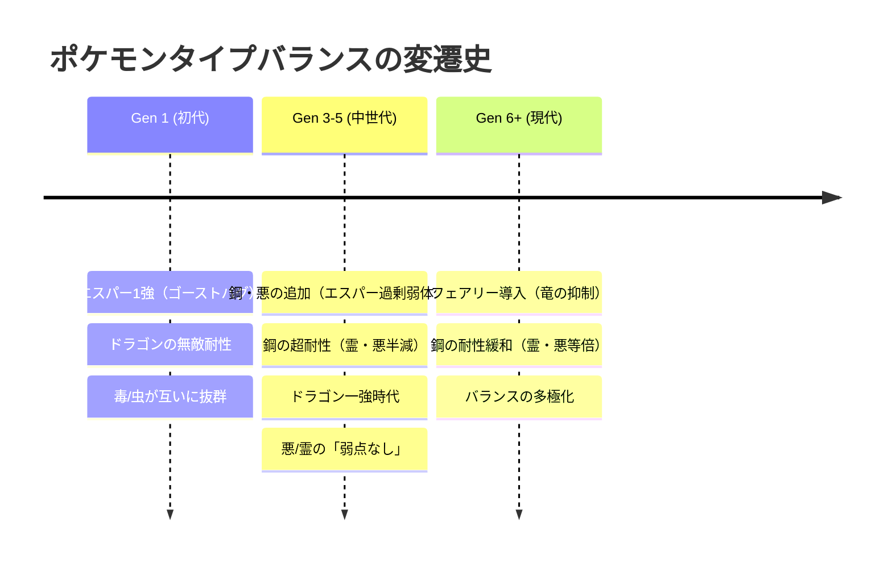
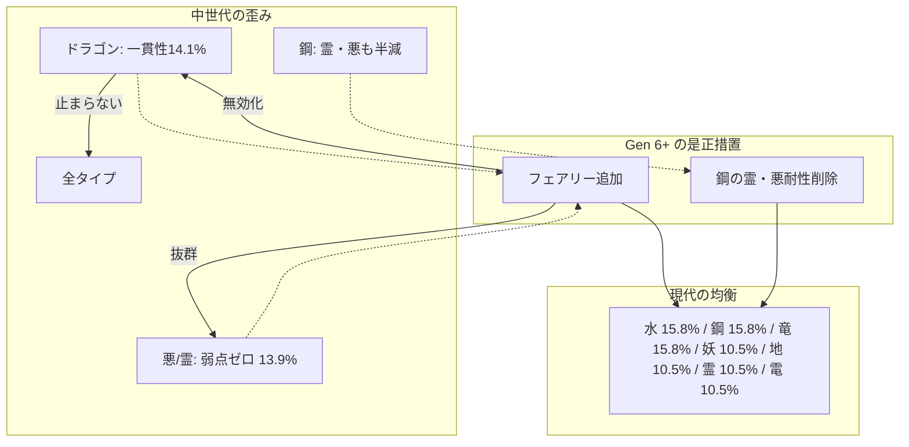

# ポケモンタイプ相性の世代別ゲーム理論分析レポート

〜 ナッシュ均衡から読み解くタイプバランスの粗さと是正の歴史 〜

## 1. エグゼクティブサマリー

ポケモンのタイプ相性は世代を追うごとに調整が重ねられてきました。本レポートでは、**初代（Gen 1）**、**中世代（Gen 3〜5）**、**現代（Gen 6+ / フェアリー登場後）**の3世代について、線形計画法を用いた**ナッシュ均衡（Nash Equilibrium）**混合戦略を算出し、その数値から各世代の「バランスの粗さ」と「公式による是正の意図」を数理的に解き明かします。

---

## 2. 世代間 単タイプ Nash 均衡確率の比較

単タイプ同士の対称マッチアップゲーム（勝敗判定行列）におけるナッシュ均衡混合戦略の確率です。

| タイプ | 初代 (Gen 1) | 中世代 (Gen 3〜5) | 現代 (Gen 6+) | 特筆すべき変遷とバランスの粗さ |
| :--- | :---: | :---: | :---: | :--- |
| **dragon (ドラゴン)** | **26.67%** (#1) | **21.43%** (#1) | **15.79%** (#1タイ) | 初代・中世代で圧倒的支配。フェアリーで遂に抑制 |
| **psychic (エスパー)** | **20.00%** (#2) | **0.00%** | **0.00%** | 初代のバグによる1強から、Gen 2以降の過剰弱体化で絶滅 |
| **rock (いわ)** | **20.00%** (#2) | **0.00%** | **0.00%** | 初代は炎・氷・飛・虫を狩る要だったが、後続世代で弱点過多に |
| **fighting (かくとう)** | **10.00%** | **14.29%** (#2タイ) | **0.00%** | 鋼・悪を狩るメタとして中世代で躍進したが、フェアリーで後退 |
| **bug (むし)** | **10.00%** | **0.00%** | **0.00%** | 初代は毒に2倍だったが、以降は半減され不遇化 |
| **steel (はがね)** | 未登場 | **14.29%** (#2タイ) | **15.79%** (#1タイ) | 登場時から最強の防御力。霊・悪等倍化後もフェアリー耐性で健在 |
| **water (みず)** | 3.33% | 10.71% | **15.79%** (#1タイ) | 世代が進むにつれ弱点の少なさと一貫性で安定した強タイプに |
| **ground (じめん)** | 3.33% | 10.71% | 10.53% | 鋼・毒・岩・電を貫く攻撃性能で中世代以降安定 |
| **ghost (ゴースト)** | 0.00% | 10.71% | 10.53% | 初代のバグ解消＆技威力向上で中世代以降主力に |
| **electric (でんき)** | 0.00% | 7.14% | 10.53% | 弱点が地面のみという優秀さで徐々にシェア拡大 |
| **fairy (フェアリー)** | 未登場 | 未登場 | **10.53%** | 竜・闘・悪を抑え、環境の調整弁として見事に機能 |
| **ice (こおり)** | 3.33% | 3.57% | 5.26% | 攻撃面は優秀だが耐性難のため一貫して低水準 |
| **grass (くさ)** | 0.00% | 0.00% | 5.26% | 弱点多数のため低水準だが、水・地面メタで現代に微浮上 |
| **確率 0% のタイプ数** | 6 / 15 (40%) | **8 / 17 (47%)** | 9 / 18 (50%) | 中世代は特定タイプの寡占（上位3タイプで50%）が激しい |

---

## 3. 各世代における「バランスの粗さ」の詳細考察

### ① 初代 (Gen 1): プログラムミスが生んだ絶対王政
1. **エスパーの支配とゴースト設計ミス**:
   - 初代のゴースト技（したでなめる等）は、本来エスパーに2倍抜群となるはずが、プログラムミスによって**0倍（無効）**となっていました。
   - あく・はがねタイプが存在せず、エスパーの弱点は実質「むし技（吸血・ミサイルばり等の低威力技）」のみでした。
   - この結果、エスパーは単タイプNashで**20.0%**を占め、防御側複合タイプでも `ghost/psychic` が**50.0%**という驚異的な数値を記録しています。
2. **ドラゴンの無敵性**:
   - 単タイプNashで堂々の**26.67%**（全世代中最高）。
   - 当時のドラゴンは氷とドラゴンしか弱点がなく、攻撃側も半減されるタイプが鋼不在のため水・草・電・炎を軽減できる耐性の塊でした。

---

### ② 中世代 (Gen 3〜5): ドラゴンと鋼の寡占、そして「弱点なし」の歪み
1. **ドラゴンの「一撃必殺・ゴリ押し」環境**:
   - 単タイプNashで**21.43%**と依然トップ。
   - 特筆すべきは、**非対称ゲームにおける攻撃側Nash確率**です。
     - **Gen 3-5: 14.13%**
     - **Gen 6+: 0.00%**
   - 中世代のドラゴン技は「はがね以外に半減されず、無効タイプが一切存在しない」ため、思考停止で逆鱗や流星群を撃つ戦法がゲーム理論的にも最適行動となっていました（第4〜5世代のガブリアス・ラティオス環境そのもの）。
2. **はがねタイプの超耐性と、エスパーの過剰弱体化**:
   - 鋼タイプは11ものタイプを半減以下に抑え、特に**ゴースト技・あく技まで半減**していました。
   - その結果、初代王者だったエスパーは「ゴーストバグ修正」「悪タイプの無効」「鋼タイプの半減」という三重苦を受け、**20.0% → 0.0% へと完全絶滅**しました。
3. **「弱点なし」という仕様の歪み (`dark/ghost`)**:
   - 非対称ゲームの防御側Nashにおいて、`dark/ghost`（ヤミラミ・ミカルゲ）が**13.93%**という極めて高い数値を叩き出しています。
   - フェアリーが存在しないため、タイプ相性上の弱点が文字通り**0個（ゼロ）**でした。この「相性で崩せない」構造はゲームバランス上の大きな粗さでした。
4. **防御側複合タイプにおける `dragon/steel` の頂点**:
   - `dragon/steel`（ディアルガ）が**19.88%**で防御側トップ。弱点が格闘・地面の2つしかなく、10タイプ耐性・1タイプ無効という圧倒的要塞でした。

---

### ③ 現代 (Gen 6+): フェアリー導入と鋼耐性削除による劇的改善
第6世代でゲームフリークが行った調整：
- **フェアリータイプの新規導入**
- **はがねタイプのゴースト・あく耐性の削除（等倍化）**

この2点により、中世代の粗さが劇的に是正されたことが数値に表れています。

1. **ドラゴンの攻撃一貫性の崩壊**:
   - フェアリーによる完全無効化（0倍）により、攻撃側Nash確率が **14.13% → 0.00%** に急落。読みのないドラゴン技のぶっ放しが牽制されました。
2. **`dark/ghost`（ヤミラミ等）の是正**:
   - フェアリー弱点がついたことで、防御側Nash確率は **13.93% → 0.00%** へ正常化。
3. **多極分散型の健全なバランス**:
   - 単タイプNashにおいて、`steel`, `water`, `dragon` が 15.79%、`ground`, `ghost`, `fairy`, `electric` が 10.53% と、**7タイプが10%以上のシェアを分け合う多極分散環境**が成立しました。

---

## 4. 結論

ナッシュ均衡の数理分析により、以下の歴史的必然性が証明されました：
1. **初代（Gen 1）**はゴーストバグと新タイプ不在により**エスパー・ドラゴンの独壇場**だった。
2. **中世代（Gen 3〜5）**はエスパーを潰しすぎた反面、**ドラゴンの止められない攻撃一貫性**、**鋼の異常な耐性**、**悪/霊の「弱点なし」**という新たな歪み・粗さを抱えていた。
3. **第6世代の「フェアリー追加」と「鋼の耐性緩和」**は、まさにこの中世代の粗さをピンポイントで狙い撃ちした**極めて精緻な是正措置**であった。
